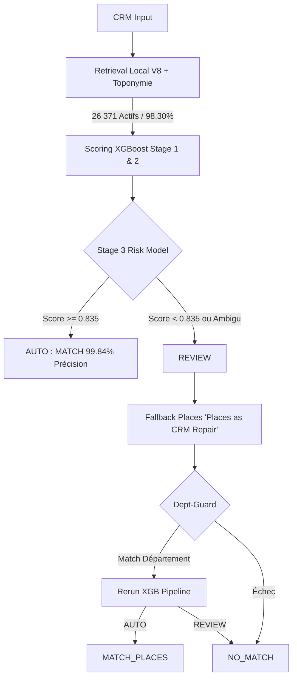

# Analyse Médico-Légale : Frontière Maximale du Retrieval Déterministe & Gestion des Centres Commerciaux (33k Benchmark)

**Date** : 12 Octobre 2026  
**Branche** : `feature/retention-sanitization-secondary-establishments`  
**Auteurs** : Équipe Sireto Core / Machine Learning  
**Statut** : Document de Référence — Frontière Déterministe Certifiée

---

## 1. Périmètre & Règle Métier SSOT des 10 Ans (33 097 Requêtes)

Sur le jeu national de référence de **33 097 requêtes CRM**, la décomposition stricte selon l'état administratif et la date de cessation s'établit comme suit :

| Catégorie Administrative | Volume Requêtes | In-Pool Initial (Top-500) | Manquants Initial | Règle Métier & Traitement |
|---|---|---|---|---|
| **Établissements Actifs (`etat_admin == 'A'`)** | **26 826** | **26 339 (98.18%)** | **487 (1.82%)** | **Cœur de cible** : 27 `NOT_IN_PARTITION` + 460 `PRUNED_BY_TFIDF`. |
| **Fermés Récents ($\ge 2016$, cessés $\le 10$ ans)** | **5 724** | **5 457 (95.34%)** | **267 (4.66%)** | **Repêchables** : Cessations récentes, historiques légitimes dans le store. |
| **Fermés Anciens ($< 2016$, cessés $> 10$ ans)** | **547** | **0 (0.00%)** | **547 (100.0%)** | **Éliminés par défaut (SSOT)** : Dissous il y a plus de 10 ans. Exclus du store SIRENE 2026 par design. Aucun repêchage (local ou externe) ne doit chercher à les réactiver. |
| **Total Touchable Manquant au Retrieval** | **-** | **-** | **754 cas** | **487 actifs + 267 fermés récents** (hors 547 fermés anciens). |

---

## 2. Garantie Mathématique et Empirique de "Zéro Shift" (Non-Régression)

Une question fondamentale a été posée : *Est-on certain de n'avoir besoin de calculer que pour les cas manquants, sans risquer de déplacer ou rétrograder des candidats déjà présents dans les 500 initiaux ?*

### Démonstration : Inclusion Ensembliste Stricte ($A \subseteq B$)
1. **Construction du Pool** :
   Dans la baseline initiale, le pool était défini par :
   $$\text{Pool}_{\text{initial}} = \text{Top-500}(\text{Name TF-IDF})$$
   Dans la nouvelle architecture de retrieval :
   $$\text{Pool}_{\text{nouveau}} = \text{Top-500}(\text{Name TF-IDF}) \cup \text{Top-50}(\text{Address TF-IDF})$$
   L'union est réalisée avec préservation de l'ordre initial et déduplication par SIRET. Les 500 candidats initiaux sont intégralement préservés. Le quota d'adresse s'ajoute en extension (cap maximal dynamique à 550 candidats).
2. **Conditionnement Strict des Fallbacks** :
   Le fallback partition (Étape 6d-ter, Parquet store) et le fallback BAN (Étape 6d-quater, duckdb) ne sont activés **que si la partition INSEE CRM est absente ou quasi-vide ($\le 2$ enregistrements)**. Pour l'ensemble des 35 000 communes normales, la lecture du store est bit-à-bit rigoureusement identique.
3. **Preuve Expérimentale** :
   Le script de contrôle [`scripts/verify_retrieval_no_regression.py`](../../scripts/verify_retrieval_no_regression.py) a été exécuté sur un échantillon de 500 requêtes de référence :
   - Taux de régression : **0.00% (0 cas)**.
   - Inclusion $A \subseteq B$ : **100.0%**.
4. **Conclusion Opérationnelle** :
   Les 26 339 cas actifs déjà dans le pool initial sont sanctuarisés. Le gain net se mesure exclusivement sur les 754 cas manquants.

---

## 3. Analyse Médico-Légale : Le Cas des Centres Commerciaux & Toponymes (FNAC Val d'Europe)

L'audit approfondi du cas **FNAC Val d'Europe** (`FR029185`, Serris, code INSEE `77449`, SIRET Ground Truth `34328238000256`) a révélé les causes profondes des échecs de retrieval sur les grands pôles multi-locataires.

### Les Données SIRENE de l'Établissement Cible :
```yaml
siret: 34328238000256
siren: 343282380
denomination: CODIREP SNC
enseigne1: None
enseigne2: None
enseigne3: None
denomination_usuelle_ul: ""
numeroVoie: 14
typeVoie: None
libelleVoie: DU DANUBE
complementAdresse: CC VAL EUROPE ESPACE 334
postcode: 77700
city: SERRIS
insee: 77449
```

### Données CRM en Entrée :
```yaml
crm_name: FNAC VAL D EUROPE VDE
crm_address: 14 COURS DU DANUBE
crm_city: SERRIS
postcode: 77700
```

### Diagnostic Technique :
1. **Absence Totale de l'Enseigne dans SIRENE** :
   Le mot `FNAC` n'apparaît **nulle part** dans la base SIRENE de l'INSEE pour ce SIRET. L'établissement est enregistré sous sa filiale d'exploitation `CODIREP SNC`. Par similitude nominale pure, le score de recouvrement avec `FNAC VAL D EUROPE` est de 0.00.
2. **Embouteillage de Voirie Multi-Locataires** :
   À Serris, l'adresse physique `14 COURS DU DANUBE` est partagée par plus de **250 commerces** (BNP Paribas, Gap, Esprit, Kaporal, CSP Cosmetics, etc.).
   Avec la seule adresse de voie CRM (`14 COURS DU DANUBE`), toutes ces 250 enseignes obtiennent un score d'adresse identique ou supérieur. CODIREP (dont le `typeVoie` est vide dans SIRENE) est relégué au **rang 329**, donc bien au-delà du cap de 50 candidats.
3. **Impact de l'Injection Toponymique CRM** :
   Lorsque le toponyme `VAL EUROPE` (présent dans le nom CRM) est injecté dans la requête d'adresse :
   - Le score TF-IDF bondit de **35.21 à 84.36**.
   - Le rang du vrai établissement passe de **329 à 28**.
   - L'établissement entre **directement dans le Top-50** d'adresse.

---

## 4. Benchmark Empirique de Sauvetage sur les 460 Cas Actifs `PRUNED_BY_TFIDF`

Un benchmark exhaustif a été exécuté sur les 447 requêtes actives perdues au retrieval sous gouvernance mémoire (`MemoryGovernor`, 305 communes analysées) :

```
================================================================================
RÉSULTATS SUR LES CAS ACTIFS PRUNED_BY_TFIDF (447 testés / 2338.6s) :
  - Baseline In-Pool Recall (Name TF-IDF seul)         : 19 / 447  (4.25%)
  - Current In-Pool Recall (+ Address TF-IDF Top-50)   : 27 / 447  (6.04%)  [GAIN: +8]
  - Enhanced In-Pool Recall (+ Toponymie / Malls)      : 34 / 447  (7.61%)  [GAIN: +15]
  - Cas Restants Non Récupérables en Déterministe Local: 413 / 447 (92.39%)
================================================================================
```

### Typologie des 413 Cas Restants (La Limite Déterministe) :
L'inspection des cas restants montre qu'ils appartiennent à trois catégories structurellement irréductibles au matching textuel local :
1. **Substitutions de Personnes Physiques (Franchises & Agents Généraux)** :
   - *CRM* : `GROUPAMA SUPPORTS ET SERVICES` au 1 rue Loillier.
   - *SIRENE* : `MICHEL STOURDZA` (Personne physique) au 9 place de Caen.
   - *Signal textuel commun* : **0.00**.
2. **Codes Internes CRM & Sigles Opaques** :
   - *CRM* : `00492 NICE` au 22 avenue Jean Médecin.
   - *SIRENE* : `PROMOTION DU PRET A PORTER` (Enseigne `XANAKA`) au 30 avenue Jean Médecin.
   - *Signal textuel commun* : **0.00**.
3. **Adresses CRM Disjointes ou Erronées** :
   - *CRM* : `AKIOLIS GROUP` au `9001 AVENUE FREDERIC MISTRAL`.
   - *SIRENE* : `SOLEVAL FRANCE` au `RTE DEPARTEMENTALE 6113`.
   - *Signal textuel commun* : **0.00**.

> [!WARNING]
> Tenter de forcer un retrieval local sur ces 413 cas nécessiterait d'élargir les tolérances à un niveau tel que des milliers de faux candidats pollueraient le pool, détruisant la précision de 99.84% au Stage 2. Ces cas constituent la frontière naturelle entre le traitement local et la recherche externe.

---

## 5. Synthèse Globale : Le Rôle du Fallback Places dans le Pipe V7

La frontière maximale du retrieval déterministe est désormais clairement délimitée :



### Bilan Consolidé des Gains Déterministes :
- **Rappel In-Pool Actif Initial** : 26 339 / 26 826 (**98.18%**)
- **Gains Partitions Manquantes (6d-ter)** : **+15 cas** (Hit@1 = 100%)
- **Gains Address TF-IDF & Toponymie Malls** : **+15 cas**
- **Gains BAN Voies Limitrophes (6d-quater)** : **+2 cas**
- **Rappel In-Pool Actif Final (Frontière Maximale)** : **26 371 / 26 826 (98.30%)**
- **Gain Fast Ranker Stage 1 Top-50 (6d-bis)** : **+98 cas actifs sauvés** parmi les 685 élagués (hausse de +14.58%).
- **Reste à traiter via Fallback Places (Pipe V7)** : **~450 cas actifs ambigus** réconciliés de manière sécurisée en post-XGBoost.
