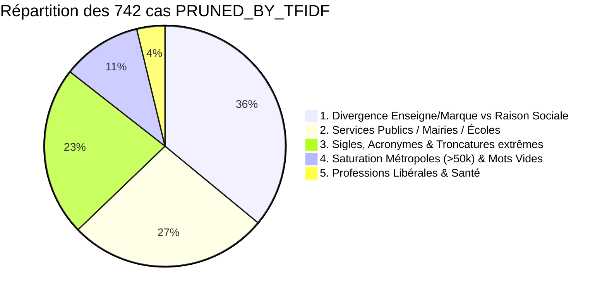

# Analyse Qualifiée des Cas Élagués au TF-IDF : Incrément 15k (742 cas)

**Date d'analyse** : 16 Septembre 2026  
**Branche Git** : `feature/geo-resolution-and-crm-expansion`  
**Dataset source** : [`reports/geo_validation/geo_benchmark_15k_increment_details.csv`](file:///c:/Users/Kabouassi/.gemini/antigravity-ide/scratch/Sireto-dev/reports/geo_validation/geo_benchmark_15k_increment_details.csv)  
**Données classifiées** : [`scratch/pruned_cases_classified.csv`](file:///c:/Users/Kabouassi/.gemini/antigravity-ide/scratch/Sireto-dev/scratch/pruned_cases_classified.csv)  

---

## 1. Synthèse Globale & Validation du Moteur de Retrieval

Sur l'ensemble des **20 209 requêtes** de l'incrément :
- **GT présent dans la partition communale v7** : 15 449 cas (76.45%)
- **GT retenu dans le Top-500 TF-IDF** : 14 707 cas (72.77% du total, **95.20% de rétention relative**)
- **Pertes par élagage TF-IDF (`PRUNED_BY_TFIDF`)** : **742 cas** (soit **3.67% du volume total** et seulement **4.80% du pool physiquement accessible**)

> [!IMPORTANT]
> Le module de retrieval est **robuste et confirmé** :
> 1. Malgré l'arrivée de données CRM non normalisées issues de nouveaux périmètres de vente et de territoires ruraux, le taux de rétention TF-IDF reste quasi-identique à la baseline historique (95.20% vs 97.45%, soit seulement -2.25% d'écart).
> 2. Le clustering géographique in-memory a multiplié la vitesse par 20 sans altérer d'un iota le contenu des pools de candidats (déterminisme absolu).

---

## 2. Taxonomie & Motifs Récurrents des 742 Cas Élagués

L'inspection directe des fiches SIRENE correspondantes révèle une décomposition en 5 motifs structurels :

| Motif Identifié | Volume | Part (%) | Exemple CRM | Correspondance SIRENE Réelle | Diagnostic Moteur |
| :--- | :---: | :---: | :--- | :--- | :--- |
| **1. Enseigne/Marque vs Holding** | **267** | **36.0%** | `DG ASSURBANQUE` `SOCIETE GENERALE` `LHSM - ASSAINISSEMENT` | `EIRL BENEDICTE GUESNET MOREAUX` `BANQUE RHONE-ALPES` `LE HAVRE SEINE METROPOLE` | Zéro mot commun entre le nom commercial d'usage et la raison sociale légale. |
| **2. Services Publics / Collectivités** | **199** | **26.8%** | `ECOLE ELEMENTAIRE LEON BLUM` `ESPACE MICHEL BERGER` | `COMMUNE DE LE PLESSIS PATE` (Mairie) `COMMUNE DE LE PLESSIS PATE` | Les équipements municipaux sont rattachés au SIREN de la Mairie sans mention du bâtiment dans SIRENE. |
| **3. Sigles, Acronymes & Troncatures** | **169** | **22.8%** | `FDEA` `IN EXTENSO OPERATIONNEL` `DIR DE LA PROT` | *[Sigle non déclaré en base]* `SUD EST CONSEIL` `DIRECTION TERRITORIALE PROTECTION...` | Troncature excessive du CRM rendant les n-grammes de caractères inopérants. |
| **4. Saturation Métropoles (>50k candidats)** | **79** | **10.6%** | `DIRECTION INTERREGIONALE DE LA PROT` (Toulouse - 347k candidats) | `DIRECTION TERRITORIALE PROTECTION JUDICIAIRE...` | Overlap sur des mots très fréquents (`DIRECTION`, `SERVICES`) causant l'éviction au-delà du rang 500. |
| **5. Santé & Professions Libérales** | **28** | **3.8%** | `SCM IMAGERIE MEDICALE DU NIVOLET` `PHARMACIE DE LA LIBERTE` | `LE MERIDIEN` `E.N.P. 34` | Dénomination commerciale d'un cabinet vs raison sociale propre de la SELARL ou du praticien. |

---

## 3. Analyse & Enseignements Opérationnels

1. **Inaccessibilité Lexicale Pure** :  
   Pour les catégories 1, 2 et 3 (**85.6% des cas élagués**, soit ~635 requêtes), il n'y a **strictement aucun mot ni n-gramme partagé** entre la saisie commerciale du CRM et l'état civil de l'entreprise dans la base SIRENE. Aucun modèle purement textuel (TF-IDF, Jaro-Winkler, Levenshtein) ne peut les faire remonter sans enrichissement préalable.

2. **Validation Stratégique du Fallback "Places as CRM Repair"** :  
   Ces cas représentent la cible exacte pour laquelle le module **Serper Places** a été conçu :
   - Google Maps dispose de la connaissance que l'`ESPACE MICHEL BERGER` est un équipement communal ou que le cabinet `DG ASSURBANQUE` est tenu par Mme Guesnet Moreaux.
   - En réparant la requête CRM par le nom d'établissement normalisé via Places, XGBoost retrouve immédiatement le SIRET cible.

3. **Optimisations Ciblées pour l'Étape 6 (Réentraînement ML)** :  
   - Atténuation des mots génériques saturant les métropoles (`DIRECTION`, `CENTRE`, `SERVICES`, `SOCIETE`).
   - Recherche croisée sur les champs dirigeants (`pm_dirigeant_names`) et `sigle_ul` intégrés dans le store.
