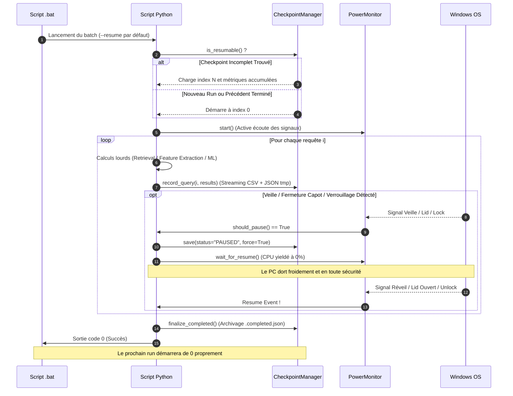

# Standard Universel de Résilience des Batchs : Checkpointing Atomique & PowerGuard

**Date d'établissement** : 21 Août 2026  
**Statut** : 🔒 **Règle Maîtresse d'Ingénierie** (Master Rule #9)  
**Composants associés** :
- Module de Checkpoint : [`src/xgb_matcher/checkpoint.py`](file:///c:/Users/Kabouassi/.gemini/antigravity-ide/scratch/Sireto-dev/src/xgb_matcher/checkpoint.py)
- Module de Supervision Veille : [`src/xgb_matcher/power_guard.py`](file:///c:/Users/Kabouassi/.gemini/antigravity-ide/scratch/Sireto-dev/src/xgb_matcher/power_guard.py)

---

## 1. Contexte & Problématique Résolue

### 1.1 Le conflit d'alimentation Modern Standby (S0ix) sous charge lourde
Sous Windows 10/11, lorsqu'un script Python exécute des calculs multi-thread intensifs (TF-IDF vectorisation, OpenMP / XGBoost matrix ops, scanning parquet) sans notifier l'OS, Windows déclenche une mise en veille moderne (`Modern Standby / Idle Timeout`).
Lors de cette transition, le gestionnaire d'alimentation (PPM) force la réduction des tensions d'alimentation (SoC Vcore / DRAM) et le gating des horloges processeur alors que les cœurs CPU tirent un courant maximal. Cette variation brutale de tension (`Vdroop` / watchdog hang) provoquait des coupures matérielles instantanées (`Kernel-Power Event ID 41`, `BugCheckCode: 0`).

### 1.2 La contrainte de transport (Sécurité Matérielle & Thermique)
Le maintien forcé de la machine en état actif lorsque le capot est fermé ou la machine transportée dans un sac fermé présente un risque critique d'emballement thermique et de décharge batterie.  
Le standard adopté garantit que **la machine entre en veille matérielle normale, froide et sécurisée**, en ramenant instantanément la charge processeur à **0%**.

---

## 2. Le Cycle de Vie Résilient

---

## 3. Spécifications Techniques des Composants

### 3.1 `CheckpointManager`
- **Écriture Atomique** : Écriture sur `<nom>.json.tmp` suivie d'un `os.replace` atomique pour garantir l'intégrité du fichier même en cas de coupure de courant brutale.
- **Sauvegarde Périodique & d'Urgence** : Sauvegarde toutes les $N$ requêtes (paramètre `--checkpoint-interval`) et vidage immédiat lors de toute demande de pause ou d'interruption.
- **Streaming des CSV de Détails** : Les résultats sont ajoutés au fichier CSV de détails au fil de l'eau, avec reprise propre sans duplication d'en-têtes.
- **Gestion du Cycle Complet** :
  - En cours : `status = "IN_PROGRESS"` dans `.checkpoints/checkpoint_<tag>.json`.
  - En pause : `status = "PAUSED"`.
  - Terminé (100%) : `status = "COMPLETED"`, archivé dans `.completed.json`.

### 3.2 `PowerMonitor`
- **Détection Multi-Canaux & Actions** :
  - **Verrouillage de session actif par défaut (`pause_on_lock=True`)** : Surveillance continue du bureau interactif Windows (`OpenInputDesktop`). Tout verrouillage manuel (`Win+L`), fermeture du capot ou écran de veille met instantanément le calcul en pause propre.
  - **Détection d'inactivité utilisateur (`idle_timeout_seconds=300.0`)** : Surveillance continue du temps écoulé depuis la dernière saisie clavier/souris (`GetLastInputInfo`). Après 5 minutes d'inactivité continue (aligné sur le seuil de veille Windows), le calcul est automatiquement mis en pause propre pour préparer la mise en veille sans surchauffe ni conflit électrique.
  - **Inhibition veille intempestive (`SetThreadExecutionState`)** : Pendant l'exécution active (écran ouvert et activité), le script informe l'OS via l'API Win32 d'inhiber la mise en veille d'inactivité ; dès la pause ou l'arrêt, l'inhibition est relâchée pour permettre à la machine d'entrer en veille matérielle froide.
  - **Détection des discontinuités temporelles** : Détection des sauts de `time.monotonic()` caractéristiques des réveils après veille ou hibernation pour réajuster la télémétrie.
  - **Capture propre des signaux console** : Capture des interruptions et fermetures (`CTRL_C_EVENT`, `CTRL_CLOSE_EVENT`, `CTRL_SHUTDOWN_EVENT`, `CTRL_LOGOFF_EVENT`).
- **Comportement de Pause Propre** :
  - Fin de la requête unitaire en cours.
  - Sauvegarde atomique du checkpoint et vidage des buffers CSV sur disque.
  - Cession intégrale du CPU (`threading.Event.wait()`) pour permettre une veille matérielle standard à 0% d'utilisation.
- **Reprise Automatique** : Dès la détection du déverrouillage, du réveil ou de la reprise d'activité utilisateur (clavier/souris), reprise immédiate et transparente des calculs à la requête $N+1$.

---

## 4. Règles d'Intégration pour tous les Fichiers `.bat` et Scripts Python

1. **Option `--resume` par défaut** : Tout script traitant des lots volumineux doit vérifier la présence d'un checkpoint inachevé et reprendre automatiquement sans redemander confirmation.
2. **Option `--fresh` disponible** : Permet à l'opérateur de forcer un redémarrage depuis la ligne 0 s'il souhaite explicitement ignorer un checkpoint partiel.
3. **Surveillance Veille & Verrouillage Active par défaut** : Le `PowerMonitor` doit être instancié avec `pause_on_lock=True` par défaut sur tous les batchs lourds (désactivable via `--no-power-monitor` ou `--no-pause-on-lock` si nécessaire pour des environnements CI/serveurs sans interface graphique).
4. **Archivage Obligatoire à 100%** : Ne jamais laisser un checkpoint actif après une exécution réussie à 100%, afin que le prochain lancement officiel produise une évaluation neuve.
