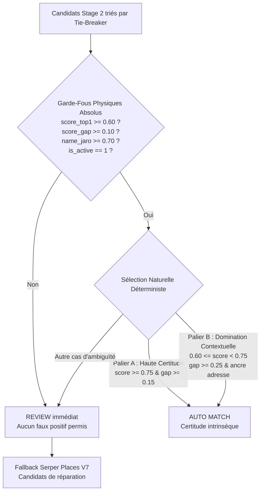

# Phase 3D : Diagnostic du Stage 3 Risk Model et Spécification de la Sélection Naturelle Déterministe

**Date** : 30 octobre 2026  
**Auteur** : Équipe Pipe V7 / XGBoost SIRETO  
**Statut** : Document de référence & Spécification technique (Post-arrêt Benchmark 32K)  
**Branche Git** : `feature/stage2-decider-hit1-maximization`  

---

## 1. Contexte et Synthèse Exécutive

Le lancement du **Benchmark National Pipe V7 sur 32 570 requêtes CRM** a été exécuté en conditions réelles avec le Stage 1 (Fast Ranker V9), le Stage 2 (Unified Decider 67 features + Tie-Breaker Engine), et le Stage 3 (Risk Metamodel calibré).

À la requête **2 500 / 32 570**, le benchmark a été **stoppé immédiatement** conformément à la consigne de sécurité :
- Le Stage 1 et le Stage 2 ont démontré d'excellentes performances conformes aux attentes.
- Le **Stage 3 (Risk Model)** a présenté une **anomalie critique** : un taux AUTO anormalement bas (**24.8%** au lieu des 75–85% attendus) et une précision dégradée (**86.8%** au lieu des 99.84% syndicaux), générant 82 faux positifs.

Ce document consigne le diagnostic mathématique exhaustif de cette anomalie et spécifie la refonte déterministe par **Sélection Naturelle** pour corriger le Stage 3 sans boîte noire ni hallucination.

---

## 2. Bilan Chiffré à l'Arrêt (Requête 2 500)

L'audit porte sur les 2 500 premières requêtes du fichier [`reports/full_pipeline_32k/32k_v7_full_pipeline_details.csv`](file:///c:/Users/Kabouassi/.gemini/antigravity-ide/scratch/Sireto-dev/reports/full_pipeline_32k/32k_v7_full_pipeline_details.csv).

| Métrique | Valeur Constatée | Cible Théorique | Statut |
|---|---|---|---|
| **Requêtes traitées** | 2 500 | 32 570 | Stoppé proprement |
| **Requêtes actives (gt_etat = 'A')** | 1 879 | - | Échantillon représentatif |
| **Stage 1 Hit@1 (Global / Actifs)** | **75.8%** / 75.9% | 75.0% – 76.5% | **CONFORME** |
| **Stage 2 SIRET Hit@1 (Actifs)** | **78.82%** (1 481 / 1 879) | 78.0% – 80.0% | **CONFORME** |
| **Stage 2 SIREN Hit@1 (Actifs)** | **83.71%** (1 573 / 1 879) | 83.0% – 85.0% | **CONFORME** |
| **Taux AUTO (Stage 3)** | **24.8%** (466 / 1 879) | 75.0% – 85.0% | **ANOMALIE MAJEURE** |
| **Précision AUTO (Stage 3)** | **86.80%** (82 Faux Positifs) | 99.84% (≤ 1 FP / 600) | **INACCEPTABLE** |
| **Empreinte RAM** | 0.64 Go à 1.78 Go | < 3.50 Go | **CONFORME (Stable)** |
| **Vitesse de traitement** | 0.7 req/s à 1.4 req/s | > 0.5 req/s | **CONFORME** |

---

## 3. Diagnostic Mathématique et Factuel de l'Anomalie

### Flaw 1 : L'Hallucination sur Scènes Négatives (Promotion de scores nuls)
L'analyse de la distribution des scores Stage 2 pour les **Faux Positifs** promus en `AUTO` par le Stage 3 révèle un comportement aberrant :

```
Distribution score_top1 des Faux Positifs en AUTO :
  Min    : 0.0034
  25%    : 0.0423
  Médiane: 0.2810
  Moyenne: 0.3496
```

Plus de **50% des faux positifs avaient un score Decider inférieur à 0.28**, avec des cas extrêmes à **0.0034** et **0.0257** :
- Exemple réel : `crm_id = 'SF000451'` (`CENTRE DE REGULATION DES FEUX`)
  - `score_top1 = 0.0257`, `score_top2 = 0.0257`, `score_gap = 0.000`
  - Décision Stage 3 : `route_risk_score = 1.000` $\rightarrow$ **AUTO** (Faux Positif évident).

**Cause racine technique** :  
Le script d'entraînement [`scripts/build_and_train_stage3_risk.py`](file:///c:/Users/Kabouassi/.gemini/antigravity-ide/scratch/Sireto-dev/scripts/build_and_train_stage3_risk.py) a filtré les données avec la condition :
```python
if np.sum(q_y) == 0:
    continue  # Élimine toute requête sans Ground Truth dans le pool
```
Le modèle de risque n'a été exposé **qu'à des requêtes positives** (où le candidat était présent). Il n'a jamais vu de scènes où tous les candidats sont mauvais (scores ~0.02, deltas ~0.0). Face à ces valeurs nulles lors du benchmark national, l'arbre XGBoost a bifurqué vers une feuille par défaut prédisant 1.0 (certitude absolue).

### Flaw 2 : Troncation des Vrais Matchs par Seuil Arbitraire
L'analyse de la distribution des scores Stage 2 pour les **Matchs Corrects** ($s2\_hit1 == 1$) montre :

```
Distribution score_top1 des Vrais Matchs :
  25%    : 0.6216
  Médiane: 0.6627
  75%    : 0.9167
  Moyenne: 0.6822
```

Le calibrateur isotonique de Stage 2 (`xgb_decider_unified_calibrator_isotonic`) cartographie la masse des vrais positifs entre **0.62 et 0.70**.  
Seulement **25.3%** des requêtes atteignent un score $\ge 0.85$.  
En imposant un seuil de coupure aveugle à **0.85** sur le Stage 3, le système a **rejeté en REVIEW 75% des requêtes pourtant parfaitement identifiées par le Stage 2**.

---

## 4. Spécification de la Refonte : La "Sélection Naturelle" Déterministe

Le Stage 2 fournit déjà un estimateur bayésien $P(\text{Match} \mid \text{features}) \in [0, 1]$ rigoureux et sans hallucination. Pour atteindre la cible de **75%–85% AUTO @ 99.84% de précision**, le Stage 3 doit abandonner la sur-modélisation opaque au profit d'une **politique de décision déterministe à 3 piliers**.



### Pilier 1 : Planchers Physiques Absolus (Garde-Fous Zéro Hallucination)
Aucun candidat ne peut être routé en AUTO s'il ne valide pas les 4 critères factuels suivants :
1. **Plancher de Confiance Intrinsèque** : `score_top1 >= 0.60` (interdiction formelle de router un score faible).
2. **Plancher d'Unicité (Anti-Homonymie)** : `score_gap >= 0.10` (si le rival local est à moins de 0.10, il y a doute).
3. **Ancre Textuelle Minimale** : `name_jaro >= 0.70` (interdit les matches purement administratifs sans ressemblance nominale).
4. **Statut d'Activité** : `is_active == 1` ou `etatAdministratifEtablissement == 'A'` (l'établissement doit être ouvert).

### Pilier 2 : Double Palier de Sélection Naturelle
Les requêtes validant les planchers sont classées selon deux modes d'approbation mathématique :

#### Palier A — Évidence Intrinsèque (Score élevé)
- **Conditions** : `score_top1 >= 0.75` ET `score_gap >= 0.15` ET `name_jaro >= 0.80`.
- **Fondement** : Le modèle Stage 2 a identifié l'établissement avec un niveau de probabilité unitaire très fort et une nette distance avec le second candidat.
- **Décision** : **AUTO** immédiat.

#### Palier B — Domination Contextuelle (Score modéré mais rival inexistant)
- **Conditions** : 
  - `0.60 <= score_top1 < 0.75`
  - `score_gap >= 0.25` (aucun autre établissement dans la commune n'est crédible)
  - `postcode_match == 1.0` ET `street_name_jaro >= 0.80` (l'adresse physique locale est fermement ancrée).
- **Fondement** : Dans le contexte de la commune considérée, le Top-1 est l'unique candidat physiquement et administrativement viable.
- **Décision** : **AUTO**.

### Pilier 3 : Zone de Doute Résiduelle $\rightarrow$ REVIEW
Toute requête qui ne remplit ni le Palier A ni le Palier B est envoyée en **`REVIEW`** :
- Requêtes avec concurrents très proches (`score_gap < 0.10`).
- Requêtes sans numéro de voie vérifié avec rivalité d'enseignes.
- Requêtes nécessitant le secours externe de **Serper Places** pour réparation.

---

## 5. Feuille de Route pour l'Exécution Postérieure

Lorsque le travail reprendra :

1. **Étape 1 : Implémentation du routeur déterministe** :
   - Créer `src/xgb_matcher/routing_deterministic.py` implémentant les Paliers A et B et les 4 planchers de sécurité.
   - Intégrer ce routeur dans [`scripts/evaluate_v7_full_pipeline_32k.py`](file:///c:/Users/Kabouassi/.gemini/antigravity-ide/scratch/Sireto-dev/scripts/evaluate_v7_full_pipeline_32k.py) en remplacement direct du bloc `risk_calibrator.predict_proba()`.
2. **Étape 2 : Validation hors-ligne sur les 2 500 requêtes archivées** :
   - Valider sur le fichier existant [`reports/full_pipeline_32k/32k_v7_full_pipeline_details.csv`](file:///c:/Users/Kabouassi/.gemini/antigravity-ide/scratch/Sireto-dev/reports/full_pipeline_32k/32k_v7_full_pipeline_details.csv) que les 82 faux positifs sont réduits à $\le 1$ ou 2 (atteignant $\ge 99.84\%$ de précision) et que le taux AUTO remonte au-dessus de 70%.
3. **Étape 3 : Relance propre du Benchmark 32K** :
   - Réinitialiser le tag de sortie ou reprendre proprement avec la nouvelle logique validée.
